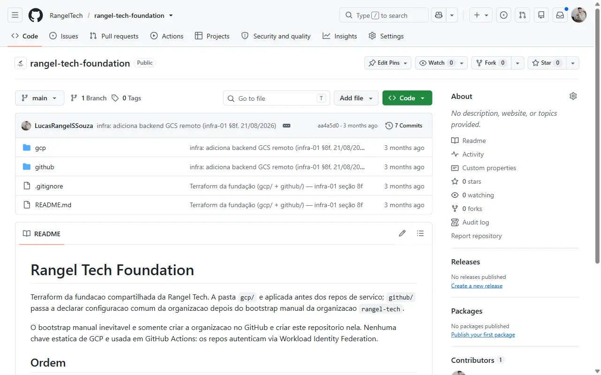

<!-- readme-padrao -->
# Fundação Rangel Tech (Terraform)

> Terraform da fundação compartilhada: pasta `gcp/` (aplicada antes dos serviços) e `github/` (configuração comum da organização; login do GitHub Actions no GCP sem chave estática).

## O que é
Terraform da fundação compartilhada: pasta `gcp/` (aplicada antes dos serviços) e `github/` (configuração comum da organização; login do GitHub Actions no GCP sem chave estática).

Estado: **infraestrutura como código (aplicada à mão, com revisão)**.

## Onde está no ar
- Sem endereço público próprio.

## Onde faz o deploy
Não tem deploy na VPS principal (infraestrutura como código (aplicada à mão, com revisão)).

## Como funciona por dentro
Resumo acima; os detalhes estão nas notas técnicas (README anterior) abaixo e na spec 57.

## Segredos
Nenhum valor de segredo fica neste repositório. Os segredos dos serviços ficam no Infisical (mapa em `vps_rt_infra/scripts/infisical/mapa_envs.json`) e chegam à VPS gerados no deploy.

## Rodar e testar localmente
Ver as notas técnicas abaixo (cada repositório tem o seu jeito); os testes de QA em produção são por cliques reais, com evidência em `new_ragente/qa/evidencias`.

## Links
- Repositório: https://github.com/RangelTech/rangel-tech-foundation
- Painel único: https://painel.rangeltech.net
- Spec de organização geral: `new_ragente/specs/57_ORGANIZACAO_GERAL_PRODUTOS_E_PAINEL.md`

## Notas técnicas (README anterior)

# Rangel Tech Foundation

Terraform da fundacao compartilhada da Rangel Tech. A pasta `gcp/` e aplicada
antes dos repos de servico; `github/` passa a declarar configuracao comum da
organizacao depois do bootstrap manual da organizacao `rangel-tech`.

O bootstrap manual inevitavel e somente criar a organizacao no GitHub e criar
este repositorio nela. Nenhuma chave estatica de GCP e usada em GitHub Actions:
os repos autenticam via Workload Identity Federation.

## Ordem

1. Aplicar `gcp/` com `billing_account_id` e `billing_alert_email`.
2. Criar a organizacao `rangel-tech` na interface do GitHub e transferir este
   repositorio para ela.
3. Aplicar `github/`, informando os outputs `github_wif_provider` e
   `github_deployer_service_account` de `gcp/`.
4. Transferir os repos de servico e aplicar os Terraform deles.

O budget de US$100 publica em Pub/Sub. A funcao `billing_blackout` desassocia a
conta de billing somente quando o gasto real comunicado for maior ou igual ao
budget. O Google pode entregar dados de billing com atraso; nao e um limitador
de custo em tempo real.
